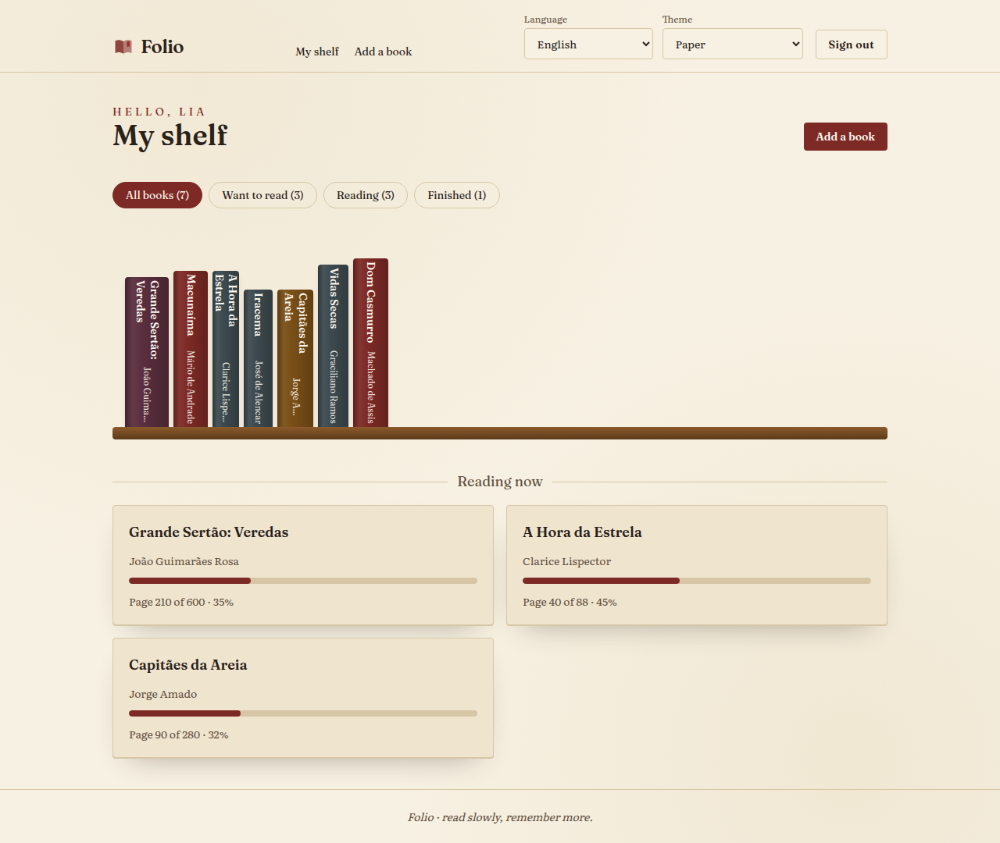
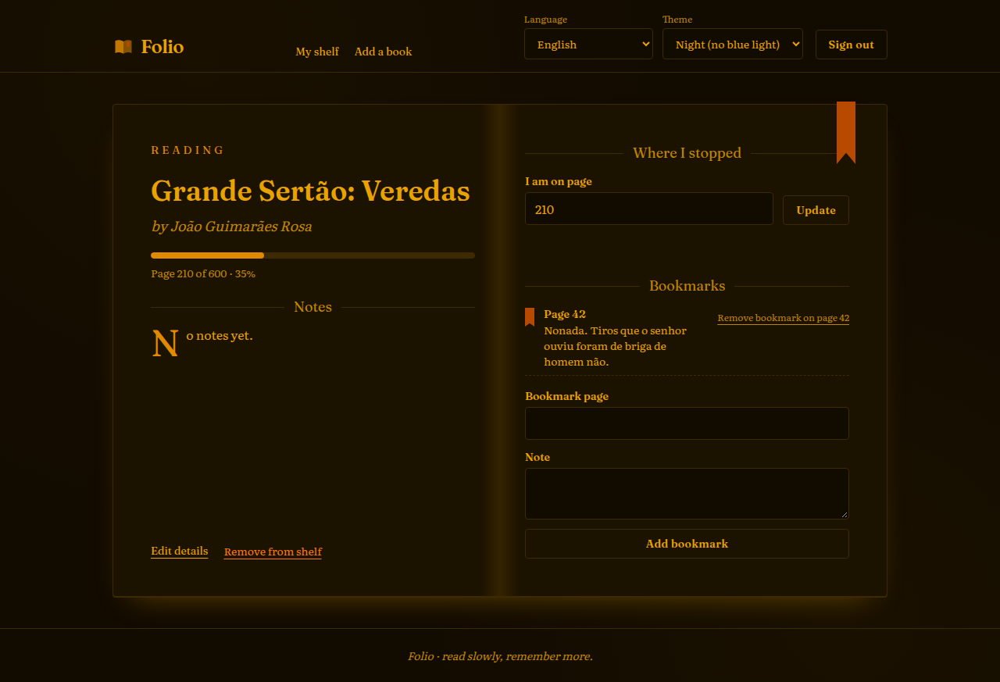

<div align="center">

# Folio

A calm reading log: keep your shelf, track the page you stopped on and bookmark the passages worth returning to.


</div>

<p align="center">
  
  
</p>

## About

Folio keeps the books you read on a shelf drawn as spines. Each book has a status (want to read, reading, finished),
the current page, a rating, notes and bookmarks. Typing the page you reached moves the status by itself.

- English and Brazilian Portuguese, picked from `?lang=`, your choice or the browser.
- Three themes: **paper**, **dark** and **night**, which removes every trace of blue light for reading before sleep.
- Accounts with hashed passwords, server sessions and a sign in rate limit stored in MongoDB.
- MongoDB runs locally through docker compose; point `MONGODB_URI` to a cluster online only when you want.

How it is built and why: [docs/architecture.md](docs/architecture.md).

## Set up on a new PC

On Ubuntu 24.04:

```bash
sudo apt update && sudo apt install -y git curl docker.io docker-compose-v2
sudo usermod -aG docker "$USER"   # log out and back in once

curl -o- https://raw.githubusercontent.com/nvm-sh/nvm/v0.40.3/install.sh | bash
nvm install 24
corepack enable

git clone <this repository> folio
cd folio
nvm use 24
pnpm install
cp .env.example .env.local
pnpm run db:up
pnpm run dev
```

Open http://localhost:8920. Check that everything is in place with `pnpm run lint && pnpm run unit:coverage`.

Outside the repository: `.env.local`, the `mongo-data` docker volume, and the MongoDB binary that the tests download
once into `~/.cache/mongodb-binaries`.

### Using a MongoDB cluster online

Keep the local database by default. To use a cluster such as MongoDB Atlas, change one line in `.env.local`:

```bash
MONGODB_URI=mongodb+srv://<user>:<password>@<cluster>.mongodb.net/?retryWrites=true&w=majority&appName=folio
```

Allow your address in the cluster network settings. Indexes are created on the first request. To go back, restore the
local line and run `pnpm run db:up`.

### Environment variables

| Variable                                     | Default                         | Meaning                                                             |
| -------------------------------------------- | ------------------------------- | ------------------------------------------------------------------- |
| `MONGODB_URI`                                | required                        | `mongodb://` or `mongodb+srv://` connection string                  |
| `MONGODB_DB`                                 | `folio`                         | Database name                                                       |
| `APP_URL`                                    | `http://localhost:8920`         | Public address; `https://` turns on secure cookies                  |
| `TRUST_PROXY`                                | `false`                         | `true` only behind your own reverse proxy, to rate limit by address |
| `MONGO_ROOT_USERNAME`, `MONGO_ROOT_PASSWORD` | `folio`, `folio-local-password` | Credentials of the local container                                  |

## Available scripts

| Command                                     | What it does                                            |
| ------------------------------------------- | ------------------------------------------------------- |
| `pnpm run dev`                              | Development server on port 8920                         |
| `pnpm run build` / `pnpm run start`         | Production build and server on port 8920                |
| `pnpm run db:up` / `pnpm run db:down`       | Start or stop the local MongoDB container               |
| `pnpm run lint`                             | ESLint, route types and TypeScript                      |
| `pnpm run format` / `pnpm run format:check` | Prettier                                                |
| `pnpm run unit` / `pnpm run unit:coverage`  | Vitest, with the 100% gate in the second                |
| `pnpm run e2e`                              | Build, then Playwright, Lighthouse and the memory check |
| `pnpm run e2e:features`                     | Only the Playwright suite, on an existing build         |
| `pnpm run check:all`                        | Everything CI runs                                      |

## Tests

- **Unit** (`src/**/*.test.ts(x)`): services and repositories run against a real `mongod` from mongodb-memory-server;
  components run in jsdom with Testing Library. Coverage of `src/lib` and `src/components` must stay at 100%.
- **E2E** (`e2e/`): Playwright on the production build, served on port 8921 by `scripts/serve-e2e.mts` with a
  throwaway database. Set `E2E_MONGODB_URI` to use another one. Requests to any other host are blocked.
- **Accessibility**: axe with WCAG 2.1 A and AA tags on every main page in all three themes, plus Lighthouse.
  See [docs/accessibility.md](docs/accessibility.md).
- **Memory**: `scripts/resource-usage.mts` signs up, adds books, saves progress, bookmarks and switches themes five
  times, and fails if the page goes over 300 MB (PSS of the Chrome renderers).

Locally, `PLAYWRIGHT_CHANNEL=chrome` reuses an installed Chrome instead of downloading Chromium.

## CI/CD

| Workflow                     | When                           | What                                                                      |
| ---------------------------- | ------------------------------ | ------------------------------------------------------------------------- |
| `check-quality.yml`          | push and PR to `main` or `dev` | ESLint, types, Prettier, compose file, `pnpm audit`, pinned actions       |
| `tests.yml`                  | PR to `main` and merge         | Unit with coverage gate, then E2E, Lighthouse and memory on a fresh build |
| `codeql-analysis.yml`        | PR, merge and weekly           | CodeQL for TypeScript and workflows                                       |
| `auto-complete-fields.yml`   | PR to `main`                   | Assigns, labels, fills the changelog, validates release branches          |
| `create-tag-and-release.yml` | merge of `release/X.Y.Z`       | Creates the tag and the GitHub release                                    |

Dependabot updates npm packages, actions and the MongoDB image monthly, waiting 3 days after each release.

## Project layout

```
src/app          routes, layout and server actions
src/server       session, locale and repository wiring for requests
src/lib          schemas, services, repositories, rate limit, i18n, themes
src/components   React components
e2e/             Playwright specs
scripts/         E2E server, Lighthouse and memory check
docs/            architecture, security, accessibility, support
```

## License

[MIT](LICENSE)
