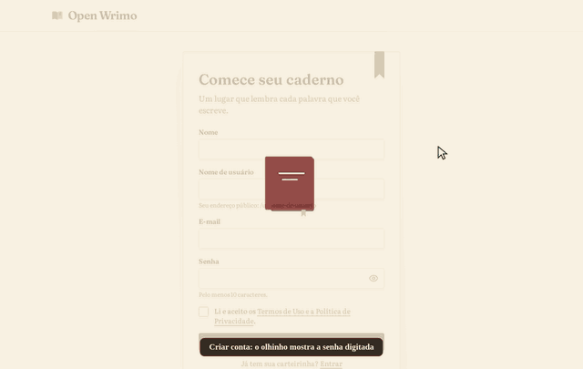

<div align="center">

# Open Wrimo

A calm place to write your novel: goals that renew every day, month or year, word counts by day and month,
writing sprints, achievements with sound and confetti, and a public profile only if you want one.


</div>

<p align="center">
  
</p>

The full tour, slower and sharper, is in [docs/demo.gif](docs/demo.gif).

## About

Open Wrimo is inspired by the way NaNoWriMo helped people finish books, rebuilt for one writer at a time. The
interface is in Brazilian Portuguese; code and docs are in English.

- **Novels**: title, cover (shown as a 3D book that follows the pointer), status (not started, in progress, completed,
  on hiatus), type, genres as chips, summary, additional details in a rich text editor with bold, headings, lists,
  quotes, links and images dropped in the text, Pinterest and playlist links, privacy per novel.
- **Goals**: between two dates, or repeating every day, month or year. Words, hours, minutes, lines or pages.
  Event shortcuts create the goal for you (November novel, 50,000 words; April and July camps, 30,000).
  Each goal shows a bar and a percent that keeps going past 100%. Goals are edited in place.
- **Updating words**: pick the book on a 3D cover shelf, add to the count or set the new total, any past day,
  with mood and place. Counts use a thousands mask. Every update can be undone.
- **Stats**: rings for the total and for today, a chart of the total against the expected pace, daily average,
  projected finish date, best day, words by month and your pace over the last 7 and 30 days.
- **Sprints**: timer or stopwatch; a soft alarm clock rings when the timer ends, then you log the words.
- **Achievements**: automatic writing badges (streaks, word milestones, a 1,667 word day, goals met, early bird,
  night owl), words across all novels (100k and 1M), participation badges and personal badges you award yourself.
  New ones pop up with a sound made in the browser; a beaten goal throws confetti.
- **Profile**: picture, name, username, bio, where and when you write, favorite books and authors, laurels for every
  goal met. It can become public at `/u/<username>`, showing only the sections and novels you choose.
- **Community**: the writers who opened their profile, with search and sorting.
- **Data**: download everything you wrote down as JSON.

Images go through one storage wrapper: the local disk (`public/uploads`, served at `/media`) or Cloudinary. Every
upload under 5 MB becomes a WebP of at most 1920×1080 and must end under 2 MB, at two uploads per second per writer.

How it is built and why: [docs/architecture.md](docs/architecture.md). The JSON API: [docs/api.md](docs/api.md).

## Set up on a new PC

On Ubuntu 24.04:

```bash
sudo apt update && sudo apt install -y git curl docker.io docker-compose-v2
sudo usermod -aG docker "$USER"   # log out and back in once

curl -o- https://raw.githubusercontent.com/nvm-sh/nvm/v0.40.3/install.sh | bash
nvm install 24
corepack enable

git clone <this repository> open-wrimo
cd open-wrimo
nvm use 24
pnpm install
cp .env.example .env.local
sed -i "s|^JWT_SECRET=.*|JWT_SECRET=$(openssl rand -base64 48)|" .env.local
pnpm run db:up
pnpm run dev
```

Open http://localhost:8920 and create an account.

Outside the repository: `.env.local`, the `mongo-data` docker volume, the uploaded images in `public/uploads` and the
MongoDB binary that the tests download once into `~/.cache/mongodb-binaries`.

### Using a MongoDB cluster online

Keep the local database by default. To use a cluster such as MongoDB Atlas, change one line in `.env.local`:

```bash
MONGODB_URI=mongodb+srv://<user>:<password>@<cluster>.mongodb.net/?retryWrites=true&w=majority&appName=openwrimo
```

Allow your address in the cluster network settings. Indexes are created on the first request.

### Environment variables

| Variable                                     | Default                                 | Meaning                                                             |
| -------------------------------------------- | --------------------------------------- | ------------------------------------------------------------------- |
| `MONGODB_URI`                                | required                                | `mongodb://` or `mongodb+srv://` connection string                  |
| `MONGODB_DB`                                 | `openwrimo`                             | Database name                                                       |
| `JWT_SECRET`                                 | required                                | At least 32 random characters; signs the access tokens              |
| `APP_URL`                                    | `http://localhost:8920`                 | Public address; `https://` turns on secure cookies                  |
| `TRUST_PROXY`                                | `false`                                 | `true` only behind your own reverse proxy, to rate limit by address |
| `STORAGE_DRIVER`                             | `local`                                 | `local` or `cloudinary`                                             |
| `LOCAL_UPLOADS_DIR`                          | `public/uploads`                        | Where the local driver writes images                                |
| `CLOUDINARY_URL`                             | none                                    | `cloudinary://<key>:<secret>@<cloud>`, required with `cloudinary`   |
| `CLOUDINARY_FOLDER`                          | `openwrimo`                             | Folder for the images in Cloudinary                                 |
| `MONGO_ROOT_USERNAME`, `MONGO_ROOT_PASSWORD` | `openwrimo`, `openwrimo-local-password` | Credentials of the local container                                  |

## Available scripts

| Command                                     | What it does                                            |
| ------------------------------------------- | ------------------------------------------------------- |
| `pnpm run dev`                              | Development server on port 8920                         |
| `pnpm run build` / `pnpm run start`         | Production build and server on port 8920                |
| `pnpm run db:up` / `pnpm run db:down`       | Start or stop the local MongoDB container               |
| `pnpm run lint`                             | ESLint, route types and TypeScript                      |
| `pnpm run format` / `pnpm run format:check` | Prettier                                                |
| `pnpm run unit` / `pnpm run unit:coverage`  | Vitest, with the 100% gate in the second                |
| `pnpm run e2e`                              | Build, then Playwright, Lighthouse and the memory check |
| `pnpm run check:all`                        | Everything CI runs                                      |

## Tests

- **Unit** (`src/**/*.test.ts(x)`): services and repositories run against a real `mongod` from mongodb-memory-server;
  components run in jsdom with Testing Library. The gate asks for 100% of `src/lib` and `src/components`.
- **E2E** (`e2e/`): Playwright on the production build, served on port 8921 by `scripts/serve-e2e.mts` with a
  throwaway database, with axe on the main pages.
- **Lighthouse and memory**: after the E2E specs, Lighthouse scores the home and sign in pages and
  `scripts/resource-usage.mts` drives five rounds of writing in Chrome, failing if the site's renderers go over 300 MB
  once the screen settles.

Locally, `PLAYWRIGHT_CHANNEL=chrome` reuses an installed Chrome instead of downloading Chromium.

## CI/CD

| Workflow                     | When                           | What                                                                      |
| ---------------------------- | ------------------------------ | ------------------------------------------------------------------------- |
| `check-quality.yml`          | push and PR to `main` or `dev` | ESLint, types, Prettier, compose file, `pnpm audit`, pinned actions       |
| `tests.yml`                  | PR to `main` and merge         | Unit with coverage gate, then E2E, Lighthouse and memory on a fresh build |
| `codeql-analysis.yml`        | PR, merge and weekly           | CodeQL for TypeScript and workflows                                       |
| `auto-complete-fields.yml`   | PR to `main`                   | Assigns, labels, fills the changelog, validates release branches          |
| `create-tag-and-release.yml` | merge of `release/X.Y.Z`       | Creates the tag and the GitHub release                                    |

Dependabot updates npm packages, actions and the MongoDB image monthly, waiting 3 days after each release.

## Project layout

```
src/app          pages, layouts, server actions and the /api/v1 routes
src/server       current user, tokens, writing context and API helpers
src/lib          schemas, services, repositories, stats, badges, storage, auth, i18n
src/components   React components (book mockup, cover shelf, editor, forms, rings, chart)
e2e/             Playwright specs
scripts/         E2E server, Lighthouse and memory check
docs/            architecture, API, security, accessibility, support and the demo GIFs
```

## License

[MIT](LICENSE)
